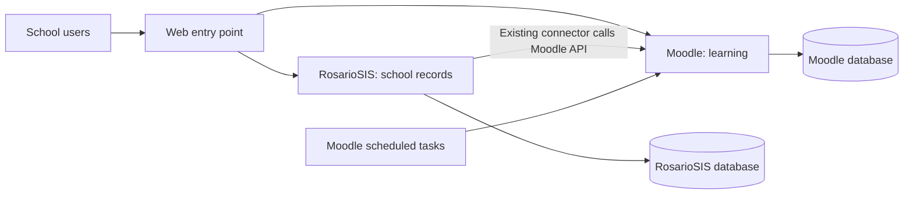

# Africa Online University: implementation and usage guide

Status: renamed to Africa Online University (AOU) on 2026-10-07. Both applications are installed and the API connection was verified in September. Full account/course/enrollment acceptance remains pending. See [the rename guide](aou-rename.md) for current addresses and data preservation.

## Scope and change handling

The platform serves one school named **Africa Online University**. The user has cloned both applications. Before editing code in either fork, explain what needs changing, why, the affected files, expected behavior, how it will be tested, and how to undo it. Do not silently edit application code or push to the forks.

Docker configuration, setup documentation, and supporting platform scripts belong in `Africa-Online-University-Platform`. Keep environment-specific application settings outside tracked fork code where possible, and document how the containers receive those settings. Explain administrative configuration changes as well, so the user can reproduce them.

## Repositories and inspected versions

| Repository | Purpose | Observed default branch |
| --- | --- | --- |
| [Africa-Online-University-Platform](https://github.com/elias0247/Africa-Online-University-Platform) | Installation, service configuration, operational scripts, and documentation | `main` |
| [neuronet.moodle](https://github.com/elias0247/neuronet.moodle) | Moodle source | `main` |
| [neuronet.rosariosis](https://github.com/elias0247/neuronet.rosariosis) | RosarioSIS source and its existing connector | `mobile` |

The trailing comma in the supplied RosarioSIS link was treated as punctuation; the repository name is `neuronet.rosariosis`.

The original fork inspection found Moodle 5.3beta on `main`. The user subsequently selected the stable 5.2.3 tag. The local development baseline now records:

- Moodle 5.2.3: `344232c15336c71b80f9aca8359ce0e0a9f3d116`, local branch `neuronet-5.2`.
- RosarioSIS 13.0: `5ece843bb8b4589b8568cb0da1929ff03da7e433`, local branch `mobile`; `Warehouse.php` declares version 13.0.

Both working trees are clean. [components.json](../components.json) records these commits, and `scripts/check-sources.py` checks them before a build. Runtime baseline: PHP 8.3 and PostgreSQL 16. Application compatibility and integration acceptance still require the installation and lifecycle tests.

The RosarioSIS fork's changelog begins with changes for 13.0. Its included Moodle plugin documents REST integration, a one-school limit, account and course operations, teacher assignments, and student enrollment/drop operations. Those documented capabilities still need testing with our selected Moodle version. See [the fork connector README](https://github.com/elias0247/neuronet.rosariosis/blob/5ece843bb8b4589b8568cb0da1929ff03da7e433/plugins/Moodle/README.md).

## How the parts connect

The diagram shows the target web entry point. For this first laptop milestone, each Apache container exposes its own local-only port: Moodle uses `http://learn.aou.test:8080` and RosarioSIS uses `http://sis.aou.test:8081`. A common HTTPS reverse proxy is deferred until staging.

Docker Compose starts and connects the services. Each application has its own PHP/Apache container. PostgreSQL hosts both databases, with a separate database owner for each application. Uploaded files live in named Docker volumes outside container images.

The optional `tasks` profile starts Moodle cron after installation. A mail catcher remains pending: Moodle mail is currently disabled and RosarioSIS mail is discarded. API tokens and database passwords stay in local secrets/configuration, not Git.

## How the first student workflow will work

1. The administrator configures Africa Online University's academic year, grades/classes, and subjects in RosarioSIS.
2. The administrator creates a test teacher and student, and assigns them to a class or course period.
3. The enabled connector sends the supported account and enrollment operations to Moodle's API. We will document which actions trigger a call and which options must be enabled.
4. We check that Moodle has the correct accounts, course, teacher role, and student enrollment.
5. The teacher adds a sample lesson and assignment in Moodle. The student signs in, opens the course, and submits the assignment.
6. We change the student's class, test withdrawal, repeat operations, and simulate an outage. We record observed behavior and any manual recovery steps.

Public applications and administrator approval will be added only after their exact behavior is tested. Automatic account creation is not the same as approval. A matching account in each application also does not provide a shared login session.

## Where people will work

| Person | RosarioSIS use | Moodle use |
| --- | --- | --- |
| Administrator | Students, staff, school calendar, classes, enrollment, attendance administration | Learning-site administration and course access checks |
| Teacher | Assigned classes and school attendance, as permitted | Lessons, assignments, quizzes, feedback, and learning grades |
| Student | School-record access where enabled | Course materials, submissions, quizzes, and feedback |
| Platform operator | Application configuration and connector troubleshooting | Application configuration, background tasks, and learning-site troubleshooting |

Official report-card grades and Moodle activity grades will remain separate until a transfer workflow is explicitly designed and tested. Parent access, shared login, and other services have not been implemented.

## Documentation delivered with each working component

Every implementation step will document:

1. **Purpose:** the problem it solves and who uses it.
2. **Files and settings:** exact locations, why each setting exists, and where secrets belong.
3. **Setup:** prerequisites and commands in the order they should be run.
4. **Daily use:** actual URLs and application menu paths, roles, and a small worked example.
5. **Verification:** expected output, observed results, and remaining limitations.
6. **Troubleshooting:** relevant logs, common failures, and recovery steps.
7. **Operations:** start, stop, restart, update, backup, restore, and rollback where applicable.

Infrastructure commands and configuration are documented in [local development](local-development.md). Exact school-workflow menu paths and integration results will be added after installation and testing.

## Server deployment later

Build versioned images from selected, recorded commits. Test them in staging, restore the databases and uploaded files together, and then configure the production domains, HTTPS, email, backups, and monitoring. Keep school settings in configuration so moving from laptop to server does not require editing application source.

After the rename, use the [new local hostname mappings](aou-rename.md) and continue testing the connector with fake school records.
